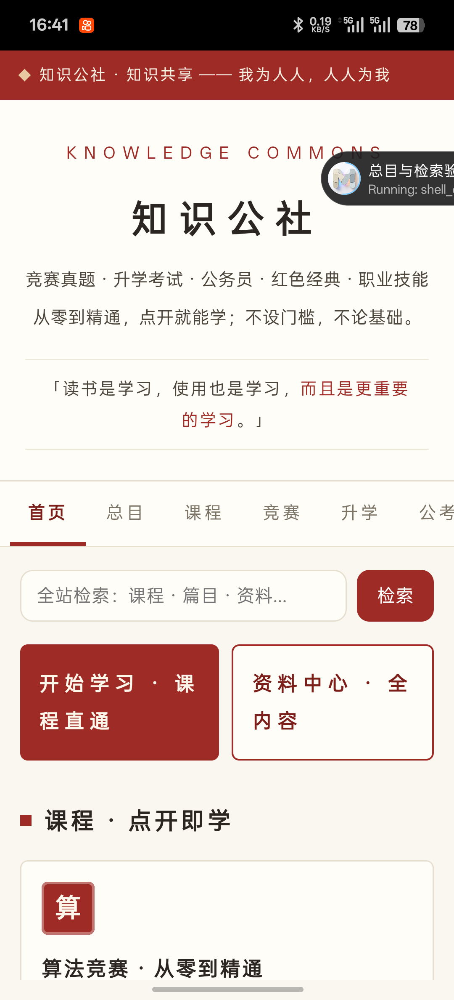
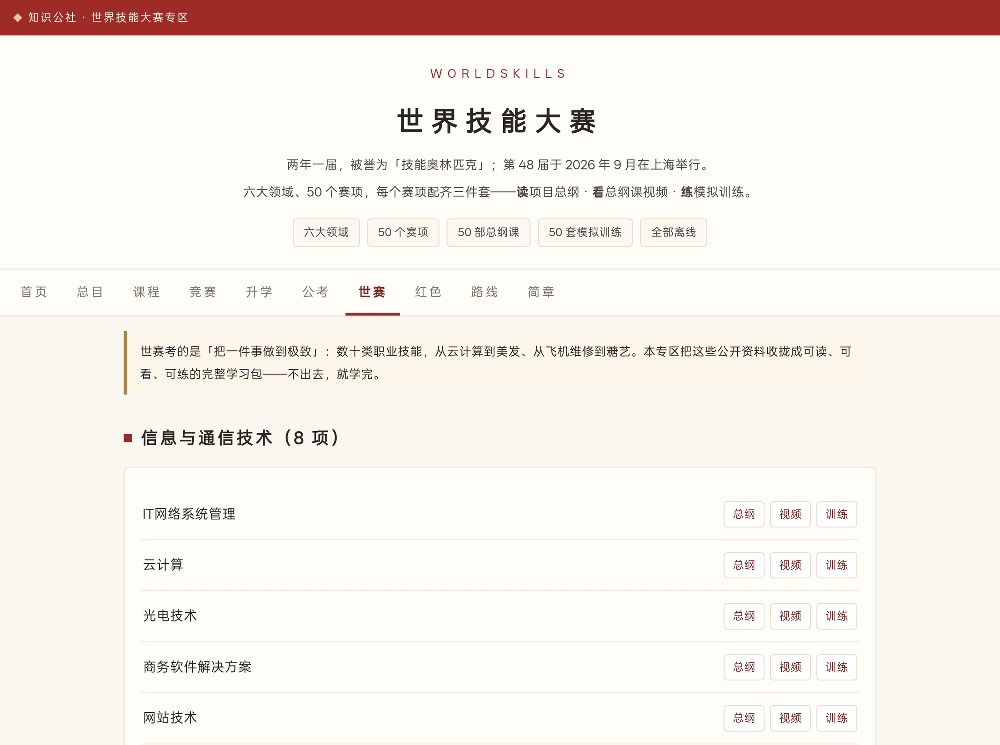

# 知识公社 · Knowledge Commons

> **让每一个人都能免费学习。**
> 竞赛真题 · 升学考试 · 公务员 · 红色经典 · 世界技能大赛 · 全网资源总库 —— 完全离线、完全开源。

不设门槛，不论基础：只要想学，这里全都有。

把散落各处的公开学习资源收集、分类、编好「从零到精通」的路线，装进同一个 App / 网站里——让"不知道去哪学、从哪开始"的人，打开就能学。

**立即使用**

- 网页版（无需安装）：https://taimabenji.github.io/knowledge-commons/learn/
  　· 手机/电脑浏览器打开后，可直接「添加到主屏幕 / 安装」——独立图标、全屏、离线可用，等于一个 App（PWA），且版本永远最新
- 资源总库（全网免费学习资源 968 条精选）：https://taimabenji.github.io/knowledge-commons/library.html
- 资料中心（全技能库 · 单文件）：https://taimabenji.github.io/knowledge-commons/study.html
- 全平台下载页：https://taimabenji.github.io/knowledge-commons/download.html
  　· Android APK / iOS IPA（含电脑签名三路线）/ Windows EXE / macOS App / Linux 单文件 / Web 六端矩阵
- 下载安装包：[Releases](../../releases) —— 六端产物统一发布



## 内容总览

| 板块 | 内容 |
|---|---|
| 全年考试日历 | 按月速查高考 / 专升本 / 考研 / 公考 / 教资 / 法考 / 软考 / 四六级 / 计算机等级的报名与笔试节奏，附官方入口 |
| 零基础学堂 | 全站使用指南 + 九大板块「第一课」+ 进阶篇，共 16 节视频 + 图文讲义：世赛 / 算法 / 升学 / 公考 / 经典 / 课程 / 编程 / 考证 / 人文——每课回答「这是什么、今天第一步做什么、学完去哪」，附动手作业 |
| 课程（原创编写） | 算法竞赛 13 讲 · Python 入门 8 讲 · 行测入门 6 讲 —— 从零开始，学完能上手 |
| 竞赛真题 | Codeforces 11425 题 + AtCoder 9600 题（离线可搜索）；ICPC 世界总决赛题解 158 份；CCPC 题面；蓝桥杯题解 168 份；天梯赛解析 28 份 |
| 升学考试 | 高考数学真卷 ×4（内置阅读器）；辽宁专升本备考助手 |
| 公务员考试 | 图形推理真题库 354 题逐题解析；国考 / 省考资料导航 |
| 红色经典 | 《毛泽东选集》第 1–5 卷全文 229 篇 + 毛泽东诗词 90 首，全部离线可读 |
| 云计算 · 睡前故事考场 | 睡前故事学习法（learn/sleep.html）：十四夜把 Linux / 网络 / Docker / K8s 讲成一座「云上之城」的连续睡前故事（网页朗读 · 语速 · 定时关闭 · 想象引导），夜里听、次日清晨随机考一卷——16 个题型族程序化随机生成 10 题（数字/场景/选项每次全变），按昨晚收听定向出题 + 隔夜复习；错题本、连续打卡、14 天进度全存本机 |
| 社会主义实践研究 | 研究生级研究中心（learn/red/socialism.html）：七大领域研究地图、21 方向选题库、六步可打卡研究路线、每日理论雷达；资源总库新增「社会主义实践研究」板块 169 条（经典文献 / 党史国史 / 新闻理论 / 数据实证 / 国际视野 / 方法升学，逐条核验）；配套研究文档九篇（docs/socialism/） |
| 世界技能大赛 | 六大领域 50 个赛项：**总纲（读）· 总纲课视频（看）· 模拟训练（练）三件套站内直达**；另含 62 集视频课与真题资料库 |
| 学习路线 | 算法竞赛 / 公务员 / 专升本 / 高考：四份「从零到精通」分阶段路线图 |
| 资源总库 | 全网免费学习资源 968 条精选（十三大板块）：世赛官方标准与真题直链、模拟器与靶场、算法 Wiki 与开源书、升学真题官方渠道、公考题库、马列古籍全文、MOOC 与 IT 工具、职业考证与语言、数字人文视听、社会主义实践研究、电商创业实战、**理工·基础学科**（数学/物理/化学/生物/天文/工程/CAD/电子/机器人/能源/材料 111 条）、**语言·艺术·生活**（外语/汉语/艺术设计/音乐/摄影/健康/法律/公益 49 条）——分类可搜，直连 / 离线性逐条标注 |
| 总目 · 全站检索 | 站内全库一页直达；离线全站索引（课程 / 篇目 / 资料一搜即中） |



## 特性

- **完全离线**：全部内容无需联网（Android 全量包约 560 MB）
- **加到桌面即装即用**：网页版为完整 PWA —— 浏览器打开即可安装到主屏幕/桌面，独立图标、离线可用、随源更新，四个系统一个体验
- **站内直达**：从首页到任一赛项、任一篇目、任一真题，全部站内一跳可达，不跳第三方
- **六端同源**：Android / iOS / Windows / macOS / Linux / Web 由同一内容源构建，GitHub Actions 一键出包
- **iOS 签名一条龙**：免签名 IPA（Sideloadly/AltStore 免费 Apple ID 侧载）＋ 电脑本机 zsign 签名脚本（Windows `sign.ps1`）＋ 云端 `sign-ios` 工作流（配证书 Secrets 自动出已签名 IPA）
- **全量质检**：每轮发布前对全部视频逐部解码体检（零基础学堂 15 集 + 机房 / 保姆级 / 进阶等系列全部逐部体检）、页面逐项实测
- **开源共建**：内容与构建流程全部开源，欢迎补充与修正

## 仓库地图

```
knowledge-commons/
├── index.html            # 门户首页
├── library.html          # 资源总库（全网免费学习资源精选，分类可搜）
├── study.html            # 资料中心 · 全技能库（单文件应用，元数据按需加载）
├── download.html install.html viewer.html   # 下载页 / 直装页 / 文档阅读器
├── 404.html              # 旧链接自动跳转（目录整理后的兼容层）
├── learn/                # 学习门户：只放页面
│   ├── index.html archive.html search.html courses.html skills.html
│   ├── contest.html paths.html beginner.html about.html sleep.html ecommerce.html
│   ├── cloud/            # 云计算：备战中心 / 实训场 / 一周·四周 / 网络专项
│   ├── courses/          # 原创课程：算法 / Python / 行测 / AWS Educate
│   ├── exam/             # 考试：题库自测 / 考试日历 / 公考 / 国防教育刷题 / 真题导航
│   ├── media/            # 视频馆 / B 站精选视频库 / 文档阅读器
│   ├── red/              # 红色经典：毛选全文 / 社会主义实践研究
│   ├── files/            # 课程与题库原始资料（730 份：ICPC / 蓝桥杯 / 图论 …）
│   └── data/  *.js  *.css  # 学习引擎、检索索引、样式
├── multiskill/           # 世界技能大赛 50 赛项学习包（总纲 / 总纲课 / 模拟训练 / 图解）
├── videos/               # 62 集视频课与图解（布局是构建契约，见 videos/README.md）
├── docs/                 # 课程文档、官方资料、研究文档、结构契约、截图
├── study-data/           # 资料中心数据分块（manifest + 58 个内容块）
├── exam/ aws-educate/    # 题库与课程源数据
├── lab/ video-ext/       # 云计算实训沙箱（引擎+场景） / 逐集图解读物
├── app/ assets/ icons/   # 站点资源（门户数据 / 截图 / PWA 图标）
├── clients/              # 六端客户端工程（android / ios / windows / macos / linux）
├── tools/                # 构建与质检脚本（见 tools/README.md）
├── video-factory/        # 视频课生成流水线（脚本 + 课件源）
└── .github/workflows/    # CI：六端构建 / iOS 签名 / 链接体检
```

内容放在哪：**页面在 `learn/`，内容数据在 `learn/files`+`study-data`+`multiskill`，产物在 `videos/`，工具在 `tools/`。**
新增一页学习内容时，请落到对应子目录；目录契约与约定见 [docs/STRUCTURE.md](docs/STRUCTURE.md)。

## 构建与质检

- **云端**：GitHub Actions —— `build-android` / `build-ios` / `sign-ios` / `build-windows` / `build-macos` / `build-linux`（workflow_dispatch，可指定上传到 Release；`sign-ios` 需配置 `IOS_P12_B64` / `IOS_P12_PASS` / `IOS_MP_B64` 三个 Secrets）
- **本地**：`clients/android/build_ci.sh` 在装有 Android SDK 的环境可直接构建；`clients/windows` 与 `clients/linux` 需 zig；`clients/macos` 与 `clients/ios` 需 macOS + Xcode；Windows 本机签 IPA：`clients/ios/sign.ps1`（zsign）
- **质检**：`tools/qc/full_media_probe.py <目录>` 对全部视频逐部解码体检（0 错误为通过）
- **链接体检**：`python tools/linkcheck.py` 并发检测资源总库全部外链（反爬识别为 blocked，多轮重试后才判死链）
- **资源名说明**：部分 Android WebView 无法访问含非 ASCII 字符的资源路径，构建流程中的 `tools/android_namefix.py` 会把中文资源名转义为 `_uXXXX` 并同步改写引用（详见脚本注释）

## study.html 秒开架构（2026-10）

资料中心 `study.html`（3161 篇 · 59 组）不再内联 14MB 全量数据，首屏体积 **14.8MB → ~757KB（-95%）**：

- `study-data/manifest.<gen8>.js` — 全量元数据（标题/分组/时长/主题色，3161 篇）+ 首页全文，~731KB
- `study-data/c/<组slug>.<hash6>.js` — 58 个按组内容块，打开该组文档时按需加载，后台自动预取全部
- 搜索：标题即时全库命中；全文匹配随内容块加载而就绪（预取完成后全库可搜）
- Service Worker：`study-data/*` 走运行时缓存，首次在线访问后全站离线可用

**再生成安全**：`tools/build_liquid.py` 末尾已接入 `tools/split_study.py`，重新生成 study.html 时自动完成拆分，无需手工步骤。改动内容数据后发布时请同步 bump `sw.js` 的 `VERSION`（如 `kc-v1.6.1`），让离线用户的缓存及时刷新。

## 数据来源与致谢

题库索引来自 Codeforces 公开 API 与 kenkoooo AtCoder Problems；
题解 / 笔记 / 真题来自公众分享的开源仓库（ACMFinalsSolutions、LanQiaoCode_Python、tianti_learning_notes、maoxuan-wiki 等）；
官方资源直达国家中小学智慧教育平台、国家数字图书馆、中国政府网等。

各资料的版权归其原始作者与机构所有。本项目仅做**收集、分类与离线化**，供个人学习交流使用，请勿用于商业用途。

## 参与共建

- 发现内容错误、想补充资料、或想参与开发 —— 欢迎开 Issue / PR
- 想加入的内容（新的科目、省份真题、赛事资料）都可以提出，收集到就会加进来

## 最近更新

- **2026-10-16**：**仓库结构整理 + 资源总库扩容至 968 条（十三大板块）** —— ① `learn/` 从 31 个平铺页面整理为 `cloud/` `courses/` `exam/` `media/` `red/` 五个分区，全站相对链接自动重写（含 JS 拼串路径），旧链接由新增的 404 页自动跳转；根目录只留站点级入口，`resources.html`（B 站精选）与 `guofang.html`（国防教育刷题）分别归入 `learn/media/` 与 `learn/exam/`；② 新增 `docs/STRUCTURE.md` 结构契约、`learn/README.md`、`videos/README.md`、`tools/README.md`、`.gitattributes`、`.editorconfig`，README 的 22 条更新日志移入 `CHANGELOG.md` 并修好表格错行；③ 资源总库新增「**理工·基础学科**」与「**语言·艺术·生活**」两大板块，并对全部新条目逐条 curl 实测（404/超时一律剔除）、与存量 779 条按 URL 去重，同时清理库内 13 条同名同址重复；PWA 预缓存升 kc-v1.9.0
- **2026-10-10（三）**：新增「**云计算 · 睡前故事考场**」（learn/sleep.html，导航「睡前」）——睡前故事学习法闭环：十四夜连续睡前故事（把 Linux/网络/Docker/K8s 讲成「云上之城」，网页朗读播放、语速可调、定时关闭、睡前想象引导、听完自动记录）+ 次日「清晨考场」10 题 8 分钟限时四选一；题目由 16 个题型族（子网/端口/权限/路径/包管理/命令选择/排错第一步/HTTP/容器/集群/DNS/日志/磁盘/最佳实践/故事呼应/昨夜故事）配随机种子当场生成——数字、场景、选项顺序每次全变，按最近一次收听定向出题并抽查更早听过的夜；错题本（做对销账）、连续打卡、14 天日历、成绩记录全存本机；全站 24 页导航加「睡前」tab；检索索引 +17；PWA 预缓存升 kc-v1.8.4
- **2026-10-10（二）**：视频馆扩容 +26 条（累计 50+）——上海 2026 分日实录（Day1/Day3 + 官方分日播放列表 + 官网视频页）、里昂 2024 Day3/官方纪录/IT 集锦、喀山 2019 四条分日与闭幕全场；新增「**B 站国内直看**」栏（第 48 届开幕式/Day2 直击/央视新闻/新闻1+1 ×2/第 44 届开幕式，全部免国际网络）与「**IT 赛项现场**」栏（云创大数据世赛云计算两讲 + 云计算/网络安全选手纪实 + 官方赛项片 + 日本 48 届代表纪实）；检索 +2；PWA 升 kc-v1.8.3
- **2026-10-10**：新增「**世赛 · 比赛视频馆**」（learn/wsvideos.html，导航「视频」）——从莱比锡 2013 到上海 2026 六届世赛官方影像收录：上海 2026（第 48 届）开闭幕式/Day4/收官 7 条、里昂 2024 集锦与开幕式 3 条、2022 特别赛/喀山 2019/阿布扎比 2017/圣保罗 2015/莱比锡 2013 历届 11 条，全部 YouTube 官方来源并经 oembed 逐条验证存活（2026-10-10）；附官方播放列表 2 份、频道入口（YouTube/Vimeo，需国际网络 w:1）、中国侧 B 站检索直达（世赛/云计算/大国工匠）与人社部官网；站内自产 50 部赛项总纲课按六大领域全导航；全站 21 页导航加「视频」tab；检索索引 +3；PWA 预缓存升 kc-v1.8.2

<sub>完整历史（23 条）见 [CHANGELOG.md](CHANGELOG.md)。</sub>

## 理念

知识并不稀缺，稀缺的是「知道去哪找、从哪开始」。
我们希望把信息差一个个消掉，让知识回归它本来的位置——**属于每一个人**。

> 无产者在这个革命中失去的只是锁链。他们获得的将是整个世界。
> **全世界无产者，联合起来！**
